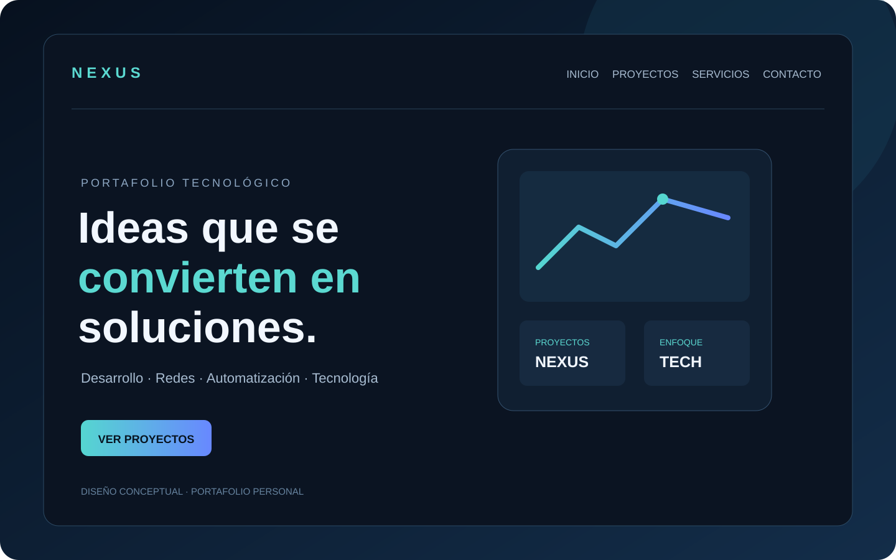

# NEXUS — Portafolio tecnológico

<p align="center">
  
</p>

**Portafolio personal de José Manuel Franco Brito** para presentar proyectos, soluciones digitales y experiencia técnica.

[Visitar sitio web](https://josefro.github.io/) · [Reportar un problema](https://github.com/JOSEFRO/JOSEFRO.github.IO/issues)

## Características

- Diseño responsive para móviles, tabletas y escritorio.
- Secciones de perfil, áreas de desarrollo, proyectos, proceso y contacto.
- Fotografías temáticas por área con carga diferida y tratamiento visual oscuro.
- Contacto mediante WhatsApp, sin backend ni base de datos.
- Metadatos básicos para compartir y motores de búsqueda.
- Sitio estático: no requiere instalación de dependencias.
- El contenido describe áreas de estudio y proyectos; no presenta como experiencia certificada aquello que está en aprendizaje.

## Vista previa

La imagen de `assets/images/nexus-portfolio-preview.svg` es una ilustración conceptual alineada con la identidad visual del portafolio; no representa una captura literal del navegador. Las fotografías de las tarjetas son referencias visuales remotas servidas por Unsplash.

## Cómo visitar el sitio

1. Abre el enlace de GitHub Pages: [josefro.github.io](https://josefro.github.io/).
2. Entra en las secciones desde el menú superior.
3. Usa el enlace de contacto para preparar un mensaje de WhatsApp.
4. Revisa el texto y envíalo desde WhatsApp si estás de acuerdo.

## Cómo descargar el código

1. Abre este repositorio en GitHub.
2. Pulsa el botón **Code**.
3. Selecciona **Download ZIP**.
4. Extrae el archivo ZIP en tu equipo.
5. Abre `index.html` en un navegador moderno.

No necesitas instalar Node.js para visualizar la versión publicada.

## Desarrollo local

Para una vista más fiel a GitHub Pages, inicia un servidor local desde la carpeta del proyecto:

```bash
python -m http.server 8000
```

Luego visita `http://localhost:8000`.

## Estructura

```text
.
├── index.html
├── README.md
├── robots.txt
├── sitemap.xml
├── .nojekyll
├── assets/
│   ├── css/styles.css
│   ├── js/main.js
│   ├── favicon.svg
│   └── images/
│       └── nexus-portfolio-preview.svg
└── docs/
    └── PROJECT-STRUCTURE.md
```

## Contacto

El formulario prepara un mensaje y abre WhatsApp; no existe un backend ni se almacenan los datos en este sitio.

- WhatsApp: **+1 (849) 252-9296**
- Correo: **josemanuelfrancobrito11@gmail.com**

El formulario no almacena información ni la envía a un servidor. Los datos se incorporan a un mensaje mediante WhatsApp y la persona puede revisarlo antes de enviarlo.

## Licencia

Este repositorio es un proyecto personal. Consulta al propietario antes de reutilizar marcas, textos o recursos visuales.
