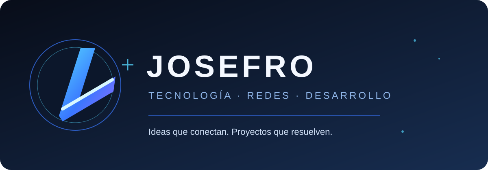
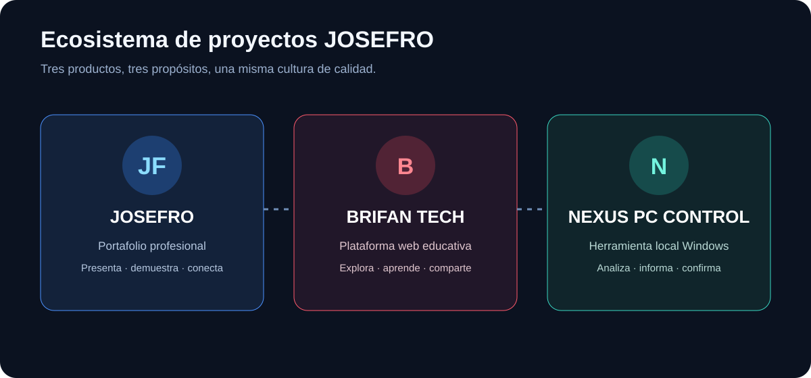

<div align="center">




# JOSEFRO · Portafolio tecnológico

**Desarrollo web · Redes y seguridad · Automatización · Herramientas digitales**

[🌐 Abrir portafolio](https://josefro.github.io/) · [📂 Explorar GitHub](https://github.com/JOSEFRO?tab=repositories) · [✉️ Contacto](mailto:josemanuelfrancobrito11@gmail.com)

</div>

## Identidad y estructura visual



[Arquitectura del sitio](docs/ARCHITECTURE.md) · [Estructura del proyecto](docs/PROJECT-STRUCTURE.md) · [Registro de cambios](CHANGELOG.md) · [Benchmark competitivo y plan de mejoras](docs/COMPETITIVE-BENCHMARK-2026-11.md)

> El arte de cabecera es conceptual. El mapa representa la estructura del ecosistema y no una captura del sitio publicado.

## Perfil

JOSEFRO es el espacio de presentación de proyectos personales, prácticas técnicas y experimentos de desarrollo. El objetivo es construir herramientas útiles, documentar sus decisiones y mejorar su calidad mediante pruebas e iteraciones.

Actualmente estudio Redes y Seguridad Informática en Loyola IEESL. Mi formación complementaria confirmada incluye Redes Básicas de Canoa Academy y NSE 3. El portafolio diferencia la formación en curso, los laboratorios personales y los productos que todavía están en desarrollo.

## Proyectos principales

| Proyecto | Tipo | Descripción | Acceso |
|---|---|---|---|
| **BRIFAN TECH** | Plataforma web | Biblioteca de guías, recursos y publicaciones tecnológicas. Se utiliza desde el navegador; no requiere instalación. | [Abrir web](https://josefro.github.io/BRIFAN-TECH/) · [Código](https://github.com/JOSEFRO/BRIFAN-TECH) |
| **NEXUS PC CONTROL** | Aplicación local Windows | Diagnóstico del sistema y análisis de almacenamiento desde el propio equipo. | [Repositorio](https://github.com/JOSEFRO/NEXUS-PC-CONTROL) |
| **Siete Raíces — Universo Web** | Web / enciclopedia | Portal de presentación, lore y universo original. No contiene el gameplay del RPG. | [Código](https://github.com/JOSEFRO/cultivation-universe-web) |
| **Siete Raíces — Juego** | Videojuego Godot | RPG de cultivo en fase de prototipo y desarrollo. | [Código](https://github.com/JOSEFRO/cultivation-universe-game) |
| **NETLAB AI** | Laboratorio de redes | Prototipo de asistente para prácticas, evidencias y conexión MCP con Packet Tracer. | [Código](https://github.com/JOSEFRO/NETLAB-AI) |
| **JOSEFRO Portfolio** | Sitio personal | Presenta proyectos, formación, áreas de práctica y vías de contacto. | [Abrir portafolio](https://josefro.github.io/) |

## Áreas de trabajo

- **Redes y conectividad:** direccionamiento IP, VLAN, switching, topologías y laboratorios.
- **Seguridad informática:** fundamentos, buenas prácticas y ejercicios en entornos propios o autorizados.
- **Desarrollo web:** HTML, CSS, JavaScript, React y TypeScript.
- **Aplicaciones y automatización:** Python, diagnóstico local, integración de herramientas y presentación de datos.
- **Videojuegos:** prototipos 3D, diseño de sistemas y desarrollo con Godot.
- **Inteligencia artificial:** experimentación con herramientas y flujos asistidos por IA.

## Estándar de desarrollo

1. Definir el problema, alcance y criterios de aceptación.
2. Investigar alternativas y seleccionar tecnologías justificadas.
3. Diseñar arquitectura, estructura y experiencia de usuario.
4. Implementar por módulos pequeños y mantenibles.
5. Añadir pruebas, validación de entradas, manejo de errores y documentación.
6. Verificar compilación, comportamiento y compatibilidad antes de publicar.
7. Documentar limitaciones y separar lo implementado de lo planificado.

## Criterios de calidad

- Identidad visual consistente y propia para cada producto.
- Diseño adaptable a móviles, tabletas y escritorio.
- Accesibilidad, navegación por teclado y respeto por movimiento reducido.
- Seguridad por diseño: secretos fuera del código, permisos mínimos y validación en servidor cuando corresponda.
- Pruebas automatizadas y revisión manual de flujos críticos.
- Documentación clara para instalar, ejecutar, configurar y solucionar problemas.
- Transparencia: no se anuncian como terminadas funciones que no han sido probadas.

## Desarrollo local

El portafolio es un sitio estático. No necesitas instalar dependencias para visitarlo.

```bash
python -m http.server 8000
```

Abre `http://localhost:8000`.

## Contacto

- Correo: josemanuelfrancobrito11@gmail.com
- WhatsApp: +1 (849) 252-9296

Los enlaces permiten iniciar una conversación; el sitio no almacena esos datos en una base de datos.

## Estado y publicación

El portafolio se publica mediante GitHub Pages. Cada proyecto enlazado mantiene su propio ciclo de desarrollo, requisitos, pruebas y limitaciones. La presencia de una imagen conceptual o de un repositorio público no significa que el producto esté terminado ni desplegado.

## Licencia

No se ha añadido una licencia de reutilización. El código y los recursos permanecen reservados a su propietario salvo autorización expresa.
