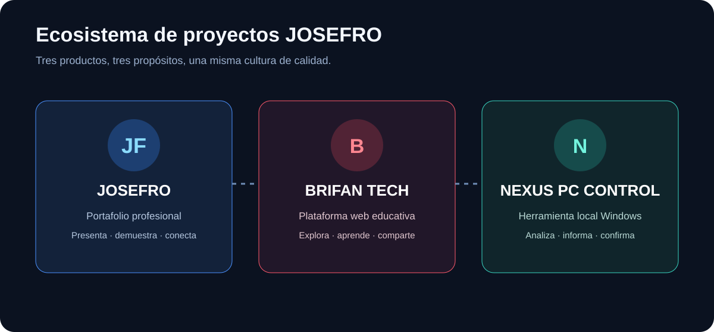

<div align="center">


# JOSEFRO · Portafolio tecnológico

**Desarrollo web · Redes y seguridad · Automatización · Laboratorios prácticos**

[🌐 Abrir portafolio](https://josefro.github.io/) · [📂 Ver repositorios](https://github.com/JOSEFRO?tab=repositories) · [✉️ Contacto](mailto:josemanuelfrancobrito11@gmail.com)

</div>

## Sobre este espacio

JOSEFRO es el portafolio de José Manuel Franco Brito. Reúne proyectos personales, prácticas técnicas y experimentos de desarrollo. Su objetivo es que cualquier visitante pueda entender rápidamente **qué hace cada proyecto, para quién sirve, cómo se utiliza y cuál es su estado real**.

> La formación, las prácticas y los productos en desarrollo se presentan por separado. No se anuncian como experiencia profesional ni como funciones terminadas aquellas que todavía no han sido verificadas.

## Ecosistema de proyectos



| Proyecto | Qué resuelve | Cómo se utiliza |
|---|---|---|
| [BRIFAN TECH](https://josefro.github.io/BRIFAN-TECH/) | Plataforma web para explorar y compartir conocimiento tecnológico. | Desde el navegador; no requiere instalación. |
| [NEXUS PC CONTROL](https://github.com/JOSEFRO/NEXUS-PC-CONTROL) | Panel local para consultar información del equipo Windows. | Se ejecuta en el propio PC y abre una interfaz local. |
| [JOSEFRO Portfolio](https://josefro.github.io/) | Presenta proyectos, formación y áreas de práctica. | Sitio estático público. |

## Áreas de trabajo

- **Redes:** direccionamiento IP, VLAN, switching y laboratorios de conectividad.
- **Seguridad informática:** fundamentos, prácticas de análisis y aprendizaje responsable.
- **Desarrollo web:** interfaces responsive, accesibilidad y experiencias interactivas.
- **Automatización:** herramientas que simplifican tareas y presentan información útil.

## Actualización visual 2026

La rama `feat/josefro-violet-editorial-redesign` introduce una dirección editorial oscura con acentos violeta, fondos geométricos sutiles y ajustes de navegación, hero, botones y tarjetas. Conserva el logotipo y el contenido existentes. La hoja de estilos se ha actualizado en una propuesta de integración; todavía falta revisar visualmente GitHub Pages en escritorio y móvil. No se ha publicado este rediseño.

## Criterios de diseño y calidad

- Identidad visual coherente y diferenciada para cada producto.
- Diseño adaptable a móviles, tabletas y escritorio.
- Navegación por teclado, estructura semántica y respeto a la preferencia de movimiento reducido.
- Documentación visual: propósito, flujo de uso, tecnologías, requisitos y limitaciones.
- Estados de proyecto transparentes: en desarrollo, probado o publicado según evidencia.

## Desarrollo local

Este portafolio es estático y no requiere instalar dependencias para visitarlo.

```bash
python -m http.server 8000
```

Abre `http://localhost:8000`.

## Contacto

- Correo: josemanuelfrancobrito11@gmail.com
- WhatsApp: +1 (849) 252-9296

El enlace de contacto abre una conversación para que la persona revise y envíe su mensaje. El sitio no almacena esos datos en una base de datos.

## Licencia

No se ha añadido una licencia de reutilización. El código y los recursos permanecen reservados a su propietario salvo autorización expresa.
