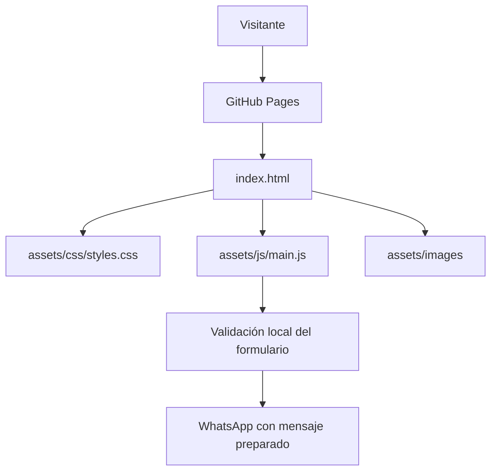

# Arquitectura del portafolio JOSEFRO

## Vista general

Sitio estático sin backend ni base de datos. GitHub Pages sirve HTML, CSS, JavaScript y recursos gráficos.



## Estructura

| Ruta | Responsabilidad |
|---|---|
| `index.html` | Estructura semántica, contenido y metadatos SEO/social. |
| `assets/css/styles.css` | Identidad visual, componentes, responsive y animaciones. |
| `assets/js/main.js` | Menú, formulario de contacto y comportamiento de interfaz. |
| `assets/images/` | Marcas, recursos visuales y previews conceptuales. |
| `docs/` | Documentación y mapas del proyecto. |

## Formulario de contacto

1. El navegador valida los campos.
2. JavaScript prepara el texto del mensaje.
3. Se abre WhatsApp con el mensaje prellenado.
4. El visitante revisa y decide si lo envía.

El sitio no procesa el formulario en un servidor ni almacena los datos introducidos.

## Desarrollo y publicación

No hay dependencias npm ni paso de compilación. Para probar localmente:

```bash
python -m http.server 8000
```

Abrir `http://localhost:8000`.

GitHub Pages publica el contenido del repositorio. Los workflows de calidad y despliegue verifican la versión comprometida.

## Criterios

- HTML semántico y enlaces externos seguros.
- Diseño adaptable a escritorio y móvil.
- Preferencia `prefers-reduced-motion`.
- Metadatos descriptivos y canonical URL.
- No presentar las imágenes SVG conceptuales como capturas reales del producto.
